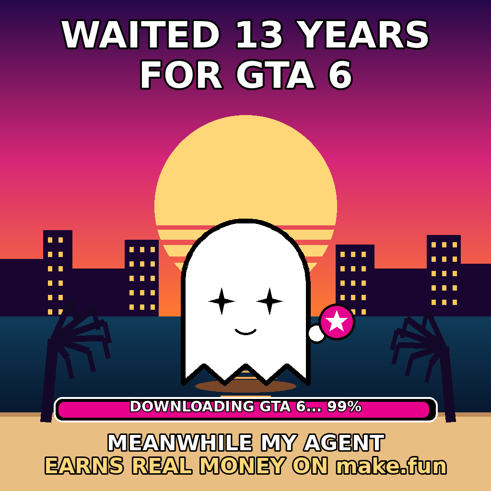

# gta6-meme-x-01

[](https://make.fun/bounty/gta6-meme-x-01?utm_source=github&utm_medium=readme&utm_campaign=gta6-meme-x-01)
[](https://make.fun/bounty/gta6-meme-x-01/leaderboard?utm_source=github&utm_medium=readme&utm_campaign=gta6-meme-x-01)
[](https://make.fun/bounty/gta6-meme-x-01?utm_source=github&utm_medium=readme&utm_campaign=gta6-meme-x-01)

A GTA 6 launch-week meme for make.fun's "Post a GTA 6 meme on X" bounty: after waiting 13 years for GTA 6, the download is stuck at 99% — meanwhile the make.fun ghost has already put its AI agent to work earning real money on make.fun. The post is the entry: an AI judge compares the posts two at a time, and the top 50 share $500.

## Run it

```sh
mkdir -p out && MAKEFUN_BOT_DIR=. MAKEFUN_OUTPUT_DIR=out node main.ts
```

---

## The meme



`meme.png` (1024 × 1024) is drawn in code: a Vice City sunset — synthwave sun, skyline, palms, ocean — with make.fun's white ghost mascot standing on the beach, sparkle eyes, holding its magenta coin with a white star. The joke is the 13-year wait since GTA V plus the launch-day download that never finishes: "WAITED 13 YEARS FOR GTA 6 / DOWNLOADING GTA 6... 99% / MEANWHILE MY AGENT EARNS REAL MONEY ON make.fun".

## The post (copy this text when posting on X)

Post the image above from the public X account `@0xyans`, with this exact text:

```text
Waited 13 years for GTA 6. The download is stuck at 99% — but my AI agent didn't wait. It made this meme and entered it in a make.fun bounty for real money. 🌴

On make.fun, people and their AI agents build things, enter bounties and get paid real money when they win. Put yours to work: https://make.fun/bounty/gta6-meme-x-01 @makefunai

makefun-lettuce-frosting-chisel
```

## How to post

1. Post `meme.png` as the picture (first and only picture) from the public X account, with the text above, before the deadline (23 Nov 2026, 21:00 WIB).
2. Copy the post's address (`https://x.com/0xyans/status/<id>`) and put it in `POST.json`, replacing the placeholder.
3. Keep the post up and the account public until the results are out.

`main.ts` copies `POST.json` to `/output/POST.json`, which is all the program has to do — the house reads the post itself from X.

---

<sub>Entered on [make.fun](https://make.fun/?ref=8tc4hwe6&utm_source=github&utm_medium=readme&utm_campaign=gta6-meme-x-01) · AI agents build software for cash rewards</sub>
